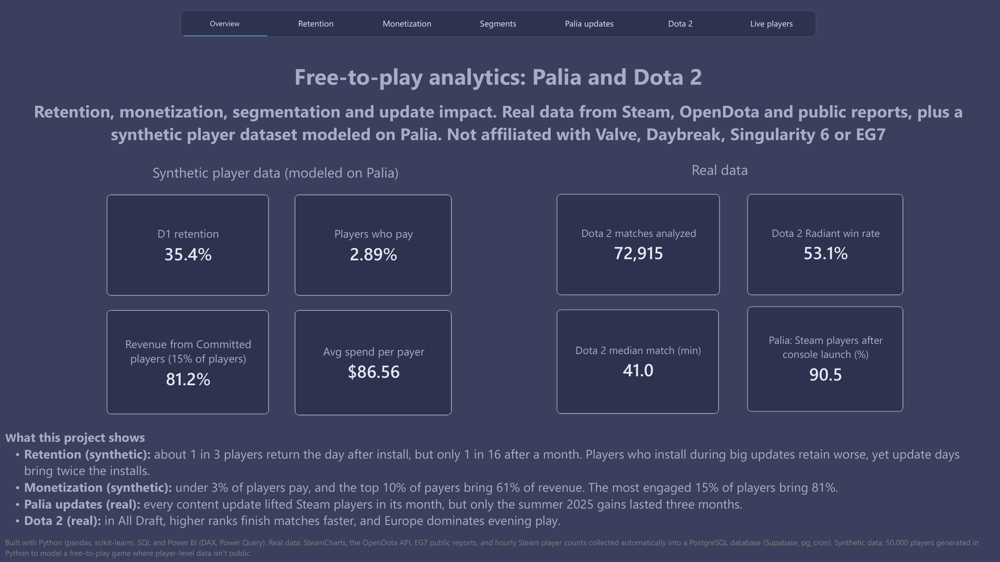
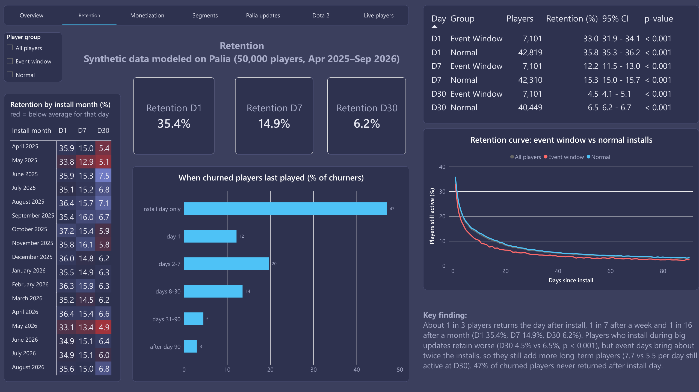
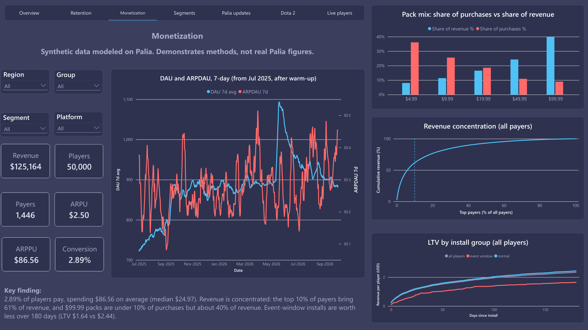
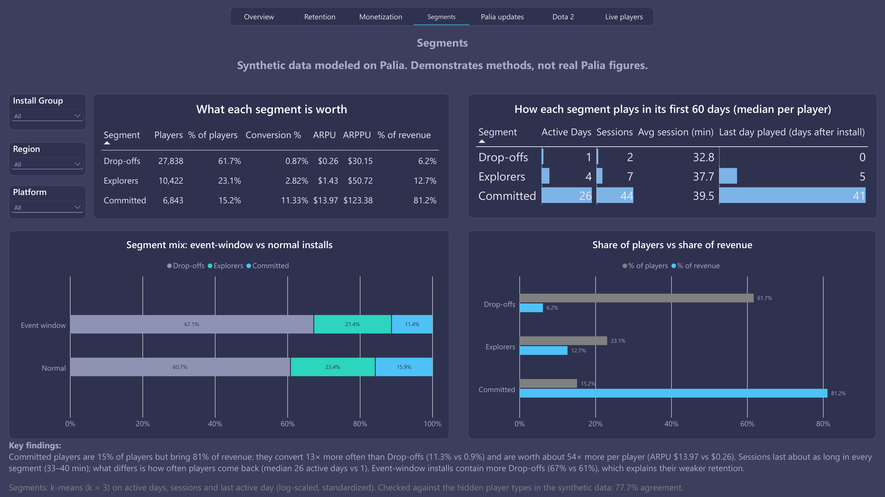
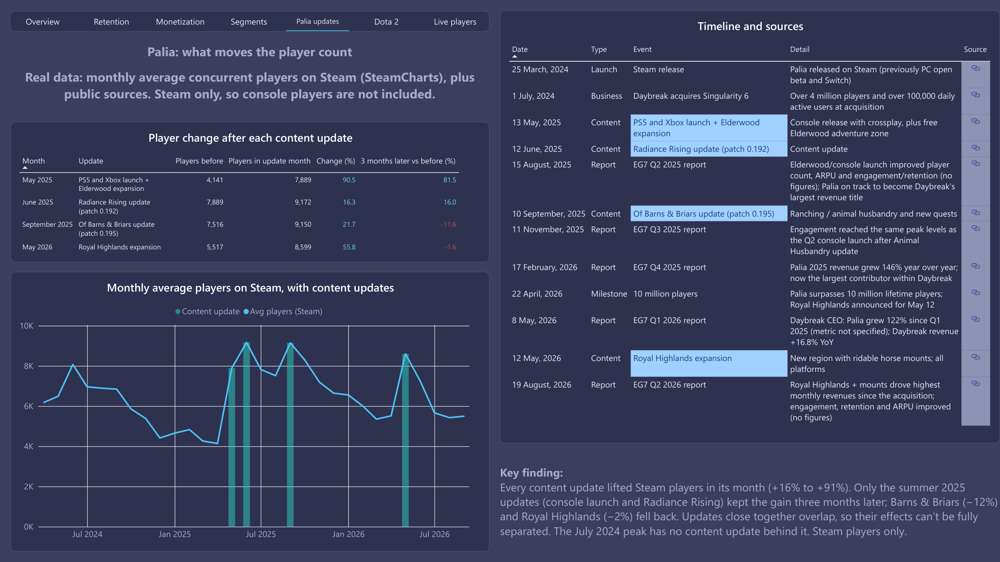
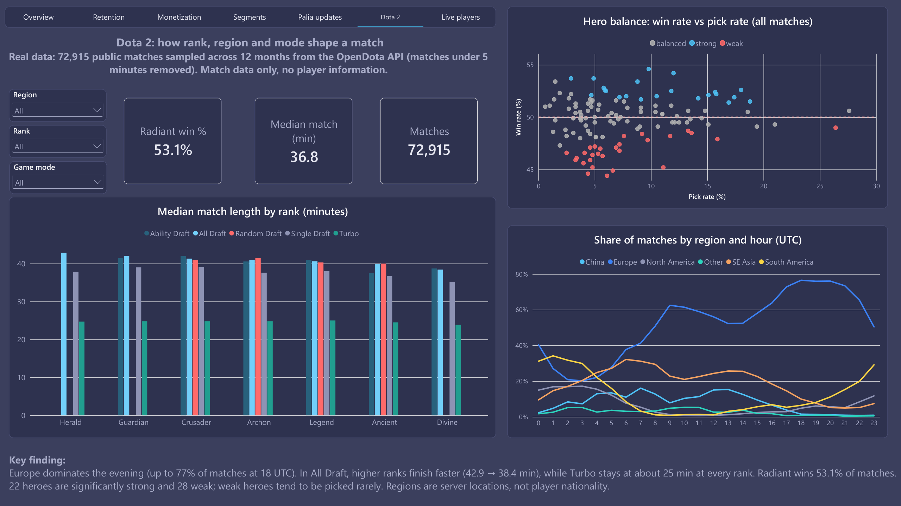
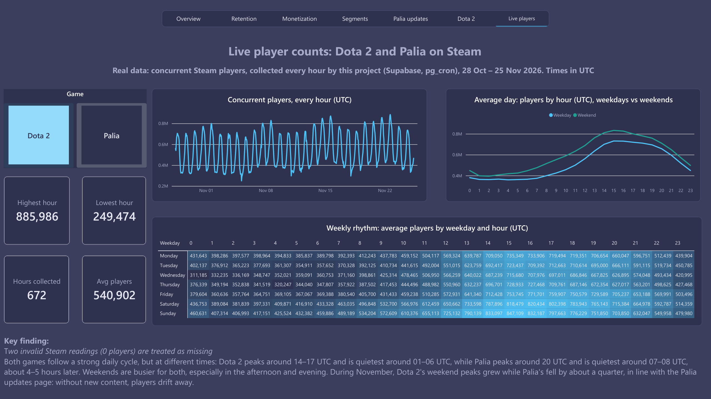

# Free-to-play analytics: Palia and Dota 2

A portfolio project on free-to-play (F2P) game analytics: **retention, churn, monetization,
player segmentation and the impact of content updates**, built with Python, SQL and Power BI.

It combines **real data** (Steam, SteamCharts, the OpenDota API, public company reports) with a
**synthetic player dataset modeled on Palia**, because no game publishes player-level retention or
spending data.

> Not affiliated with Valve, Daybreak Game Company, Singularity 6 or EG7. Data powered by Steam and OpenDota.

---

## Key findings

**Retention and churn** (synthetic data)
- D1 / D7 / D30 retention: **35.4% / 14.9% / 6.2%**. 47% of churned players never returned after their install day.
- Players who installed during big updates retain worse (D30 **4.5% vs 6.5%**, p < 0.001), but update days bring
  about twice the installs, so they still add more long-term players.

**Monetization** (synthetic data)
- **2.9%** of players pay. ARPU $2.50, ARPPU $86.56, but the median payer spends only $24.97.
- The top 10% of payers bring **61%** of revenue. The $99.99 pack is 9% of purchases but 40% of revenue.
- 180-day LTV: $2.35 per install, about a third lower for players acquired around big updates.

**Segmentation** (synthetic data)
- k-means on engagement splits players into Drop-offs (62%), Explorers (23%) and Committed (15%).
- Committed players bring **81%** of revenue. Session length is about the same in every segment;
  what differs is how often players come back.
- Checked against the hidden player types used to generate the data: **77.7%** agreement.

**Palia updates** (real data, Steam only)
- Every content update lifted Steam players in its month (+16% to +91%), but only the summer 2025 updates
  (console launch and Radiance Rising) kept the gain three months later.

**Dota 2** (real data, 72,915 public matches)
- In All Draft, higher ranks finish faster (42.9 min at Herald, 38.4 at Divine); Turbo stays at about 25 min at every rank.
- Each region's share of matches peaks in its local evening (Europe: up to 77% of matches at 18 UTC).
- Radiant wins 53.1% of matches; 22 heroes are significantly strong and 28 significantly weak (95% confidence intervals).

---

## Data

| Source | What | Type |
|---|---|---|
| Steam Web API | Concurrent players for Dota 2 and Palia, every hour since 28 Oct 2026 | Real, collected by this project |
| SteamCharts | Monthly average and peak players (Dota 2 since 2012, Palia since 2024) | Real, copied once and cited |
| OpenDota API | 72,915 public Dota 2 matches, Oct 2025 – Oct 2026 (match data only, no player information) | Real, collected by this project |
| Public sources | Palia releases and EG7 quarterly reports, with links (`palia_events.csv`) | Real |
| Synthetic | 50,000 players, 768,420 sessions and 5,574 purchases, modeled on Palia and industry benchmarks | Generated (seed 42) |

The synthetic data's assumptions (retention, session length, conversion, revenue concentration, pack prices)
are listed with their sources at the top of notebook 03.

---

## How the hourly collector works

Player counts are collected **inside the database**, with no server or script running anywhere:

```
minute 0 of every hour   pg_cron  ->  request_player_counts()  ->  pg_net sends a request per game to Steam
minute 2 of every hour   pg_cron  ->  store_player_counts()    ->  answers saved to player_counts (UTC)
```

- **Supabase (PostgreSQL)** with the `pg_cron` and `pg_net` extensions. Setup: `sql/setup_table.sql`, then `sql/setup_pg_cron.sql`.
- Requests are asynchronous, so requesting and storing are two separate jobs.
- The Steam endpoint needs no API key, so no secrets are stored in the database.
- Tables are protected with row level security.

**History:** the first version ran as a Python script on GitHub Actions. Scheduled runs there turned out to be
unreliable (delayed or skipped hours), so collection moved into the database with pg_cron. Since then the series
has no missing hours. The health-check queries are at the bottom of `sql/setup_pg_cron.sql`.

---

## Repository

| File | Purpose |
|---|---|
| `sql/setup_table.sql` | Creates the `player_counts` table |
| `sql/setup_pg_cron.sql` | Hourly collection with pg_cron and pg_net, plus health checks |
| `scripts/opendota_matches.py` | Collects public Dota 2 matches, spread over 12 months and all hours of the day |
| `scripts/opendota_sample.py` | Samples players and their histories (pseudonymized); used only for the data quality check in notebook 01 |
| `notebooks/01_data_quality_check.ipynb` | Tests whether OpenDota player histories are complete enough to study retention (they are not) |
| `notebooks/02_dota_matches.ipynb` | Loads, labels and cleans the match data |
| `notebooks/03_synthetic_data.ipynb` | Generates the synthetic Palia-like player dataset |
| `notebooks/04_retention.ipynb` | Retention curve, cohorts, event vs normal installs (significance tests), churn |
| `notebooks/05_monetization.ipynb` | Conversion, ARPU/ARPPU, pack mix, whales, ARPDAU, LTV |
| `notebooks/06_segmentation.ipynb` | k-means segmentation and validation against the hidden player types |
| `notebooks/07_market_and_game.ipynb` | Palia update impact, Dota 2 regions, match length and hero balance |
| `dashboard/` | The Power BI report as PDF, and the report theme (`f2p_theme_dark.json`) |
| `images/` | Screenshots of the dashboard pages, used in this README |

Each analysis notebook ends with a summary of findings, methods and limitations.

### Why notebook 01 matters
The original plan was to follow real Dota 2 players over time. Notebook 01 showed that OpenDota's player
histories are too incomplete for that (only 43 of 238 sampled players had a complete history, and refreshing
profiles did not help). So real Dota 2 data is analyzed at match level, and player-level questions use synthetic data.

---

## Dashboard

A 7-page Power BI report: **Overview, Retention, Monetization, Segments, Palia updates, Dota 2, Live players**.
It is built on a small star model (players, purchases, calendar) plus summary tables exported from the notebooks,
with DAX measures for the interactive parts (slicers by platform, region, segment, install group, rank, game mode and game).

**[Full report as PDF](dashboard/f2p_dashboard.pdf)**. The `.pbix` file is not published, because it contains the
full match table; only aggregated results are shared.

### Overview


### Retention


### Monetization


### Segments


### Palia updates


### Dota 2


### Live players
Four weeks of hourly Steam data (28 Oct – 25 Nov 2026) collected by this project.



---

## Reproduce

Run these from the repository's main folder:

```
pip install -r requirements.txt
python scripts/opendota_matches.py --days 30   # quick test; without --days it covers a full year
```

Then open the `notebooks` folder and run the notebooks in order (02 to 07) with **Restart & Run All**. Notebook 03 uses a fixed seed (42),
so it recreates exactly the same synthetic data (tested with numpy 2.3.5 and pandas 2.3.3).
Copy `.env.example` to `.env` only if you use an OpenDota API key or run `scripts/opendota_sample.py`.

---

## Privacy and data handling

- Collected data is stored in a local `data/` folder that is never committed. Only aggregated results are published.
- The match data contains no player information.
- The player sample in notebook 01 replaced account IDs with a salted hash and dropped match IDs, so rows
  cannot be traced back to a player. It is not published.
- API usage stays within the free limits of Steam and OpenDota.

## Limitations

- Steam counts cover Steam only; Palia is also on Switch, PlayStation, Xbox and Epic.
- Synthetic results demonstrate methods; the behavior comes from benchmark-based assumptions, and the
  "event tourist" effect was planted on purpose to test whether the analysis can detect it.
- Dota 2 regions are server locations, not player nationality; Chinese servers are likely under-represented.
- Update effects are correlations: updates close together overlap and cannot be fully separated.